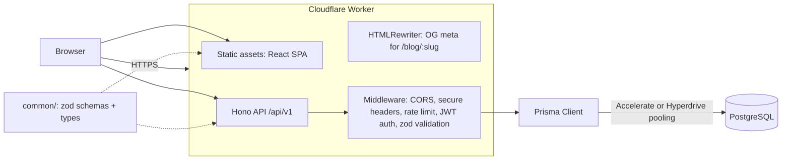

# Project Audit & Roadmap — Medium-style Blog on Cloudflare Workers

> Audit date: 2026-10-22 · Commit audited: `d964397` (9 commits, 2024-04-26 → 2026-10-02)
> Scope: every tracked file in `backend/`, `common/`, `frontend/`, plus `README.md`.
> No application code was modified during this audit. This file is the only addition.

**How to read this document**

| Label | Meaning |
|---|---|
| ✅ **Confirmed** | Verified by reading the code *and/or* running a command (command shown). |
| 🔎 **Code-confirmed** | Clear from reading the code; not exercised at runtime (no database was available). |
| ❓ **Assumption** | Reasonable inference that I could not verify. Treat with care. |

---

## Implementation status (updated 2026-10-22, after the Inkstack rebuild)

The audit below describes the repository **as it was** at `d964397`. Since then the
project was rebuilt as **Inkstack** following this roadmap. Status of each item, verified
locally (typecheck, lint, 38 API tests in workerd against Postgres, 16 web tests,
production build, and a local run of the production Worker):

| Roadmap item | Status | Notes |
|---|---|---|
| 0.1 Hash passwords + verify on sign-in (S-1, S-2) | ✅ Done | PBKDF2 100k; legacy plain-text rows upgraded on sign-in. Iteration count explained in `docs/adr/0002` (Workers production cap; the "600k" suggestion in §6 would break production). |
| 0.2 JWT `exp`, pinned `alg`, Hono upgrade (S-3, S-4) | ✅ Done | Hono 4.13.13; HS256 pinned; 7-day expiry; session moved to an HttpOnly cookie (S-9, ADR 0003). |
| 0.3 Restrict CORS (S-5) | ✅ Done (stronger) | Single origin in dev (Vite proxy) and prod (one Worker), so **no CORS at all**, plus a CSRF Origin check. |
| 0.4 Secrets out of `[vars]` (S-8) | ✅ Done | `.dev.vars` / `wrangler secret put`; examples committed. **Rotating the old live Worker's secret is still on you** if that Worker is kept. |
| 0.5 Remove sensitive logs | ✅ Done | Only structured error logs with a request id remain. |
| 0.6 Repo hygiene (A-4) | ✅ Done | `.wrangler/tmp` and editor backups removed (uncommitted deletions); ignores added. |
| 0.7 Frontend dependency upgrades (S-10) | ✅ Done | `npm audit --omit=dev`: **0 vulnerabilities**. Dev-only tooling advisories remain (Tailwind 3, Wrangler's local simulator). |
| 1.1 Test harness | ✅ Done | `@cloudflare/vitest-plugin` (renamed from vitest-pool-workers) + Vitest/jsdom for the web app. |
| 1.2 Validation + central errors (B-3, B-4, B-5) | ✅ Done | `zValidator` with shared schemas; consistent error shape; 400/401/403/404/409/429. |
| 1.3 Shared types + middleware (A-1, A-2) | ✅ Done | |
| 1.4 Schema migration (A-6, B-9, B-10) | ✅ Done | Hand-written migration backfills slugs/excerpts and keeps old posts published; Prisma diff confirms schema = DB. |
| 1.5 REST + pagination + public reads (P-1, P-2) | ✅ Done | Cursor pagination, excerpts stored on write, Cache-Control on public GETs. |
| 1.6 Frontend API layer + error states (B-1, B-2, A-7, A-8) | ✅ Done | TanStack Query; loading/empty/error/404 states. |
| 1.7 Auth UX | ✅ Done | Logout, user menu, route guards with safe `?next=`, real forms with labels. |
| 1.8 Monorepo + `common` (A-3) | ✅ Done | npm workspaces; `@inkstack/common` consumed from source, no npm publishing. |
| 1.9 CI | ⚠️ Written, not yet run | `.github/workflows/ci.yml`. It has only run locally command by command; it runs for real on the first push. |
| 2.1 Drafts, edit, delete | ✅ Done | Plus an unsaved-changes guard in the editor. |
| 2.2 Markdown + sanitisation | ✅ Done | No raw HTML; XSS tests. |
| 2.3 Tags & search | ✅ Done | `ILIKE` search (Postgres FTS is a later step). |
| 2.4 Author profiles | ✅ Done | Plus bio editing. |
| 2.5 Rebrand + real landing page | ✅ Done | Inkstack name, logo, metadata; fake posts/testimonial/dead links removed. |
| 2.6 Rate limiting (S-7) | ✅ Done | Workers Rate Limiting binding. |
| 2.7 Security headers (S-13) | ✅ Partly | `secureHeaders()` on all Worker responses; **no CSP yet**. |
| 3.1 Deploy SPA + API together | ✅ Configured, not deployed | `[env.production]` with static assets; verified with `wrangler dev --env production` locally. |
| 3.2 Edge OG meta (F-8) | ✅ Done | Verified locally; regression test included. |
| 3.3 OpenAPI docs (F-9) | ❌ Not done | API table in the README instead. |
| 3.4 Observability | ✅ Partly | Workers observability enabled, request ids, `/health`. |
| 3.5 HttpOnly cookie auth | ✅ Done | See 0.2. |
| 3.6 DB layer | ✅ Done (forced) | Prisma Accelerate retires 2026-12-01, so moved to Prisma 7 + `adapter-pg` (ADR 0001). Hyperdrive not yet set up. |
| 3.7 Seed + demo account | ✅ Done | `npm run db:seed -w backend`. |

**Bugs found and fixed during the rebuild** (each now has a test): PATCH defaults
wiping tags and unpublishing posts; a database connection leaked per request;
accented characters breaking slugs; the edge link-preview page rendering without the
app (assets redirect `/index.html` → `/`); a 500 for unknown post slugs; CSRF errors
not using the JSON error format.

**Not verified:** anything requiring a deployment (production latency, the real PBKDF2
cap, CI on GitHub), screenshots, Lighthouse, and screen-reader testing.

---

## Table of contents

1. [Project overview & current status](#1-project-overview--current-status)
2. [The real-world problem & proposed positioning](#2-the-real-world-problem--proposed-positioning)
3. [Key issues with evidence](#3-key-issues-with-evidence)
4. [Internet research & references](#4-internet-research--references)
5. [Recommended features & technical improvements](#5-recommended-features--technical-improvements)
6. [Prioritized action plan (roadmap)](#6-prioritized-action-plan-roadmap)
7. [Testing, security, performance & deployment](#7-testing-security-performance--deployment)
8. [Portfolio & recruiter presentation](#8-portfolio--recruiter-presentation)
9. [Resume bullets & interview preparation](#9-resume-bullets--interview-preparation)
10. [Final checklist](#10-final-checklist)
11. [Limitations of this audit](#11-limitations-of-this-audit)

---

## 1. Project overview & current status

### 1.1 What it is

A Medium-style blogging app in three packages:

```
frontend/  React 18 + TypeScript + Vite 5 + Tailwind 3 + React Router 6 + Axios
   │  Authorization: Bearer <JWT from localStorage>
   ▼
backend/   Hono 4.2.6 on Cloudflare Workers (Wrangler 3)
   │  Prisma 5.12 edge client + Prisma Accelerate (connection pooling over HTTP)
   ▼
PostgreSQL (2 tables: User, Post)

common/    zod schemas, published to npm as @ajayvish/medium-common@1.0.1
```

### 1.2 Inventory (what actually exists)

| Area | Files | Notes |
|---|---|---|
| API entry | `backend/src/index.ts` | Mounts 2 routers, `cors()` with defaults |
| Auth routes | `backend/src/routes/user.ts` | `POST /signup`, `POST /signin` |
| Post routes | `backend/src/routes/blog.ts` | Auth middleware + `POST /`, `PUT /`, `GET /bulk`, `GET /:id` |
| Schema | `backend/prisma/schema.prisma`, 1 migration | `User(id,email,name,password)`, `Post(id,title,content,published,authorId)` |
| Shared types | `common/src/index.ts` | 4 zod schemas + inferred types |
| Pages | `frontend/src/pages/*.tsx` | Landing, Signup, Signin, Blogs feed, Blog detail, Publish |
| Data hooks | `frontend/src/hooks/index.ts` | `useBlog`, `useBlogs` |
| Tests | — | **None** in any package |
| CI | — | **None** (no `.github/workflows`) |

### 1.3 What I ran and what happened

| Check | Command | Result |
|---|---|---|
| Frontend type-check | `cd frontend && npx tsc --noEmit` | ✅ Passes |
| Frontend lint | `npm run lint` | ✅ Passes (0 warnings), but the config has no React/a11y rules, so it catches little |
| Frontend build | `npx vite build` | ✅ Builds: JS 224.74 kB (71.23 kB gzip), CSS 18.85 kB |
| Backend type-check | `cd backend && npx tsc --noEmit` | ❌ **58 errors**, all in `lib.dom.d.ts` vs `@cloudflare/workers-types` conflicts. With `--skipLibCheck` the app code passes. There is no `typecheck` script. |
| Backend bundle | `npx wrangler deploy --dry-run` | ✅ Bundles: 456.98 KiB (96.89 KiB gzip). Shows a stray var `compatibility_date` (see §3, S-8) |
| Dependency audit (backend) | `npm audit --omit=dev` | ❌ `hono@4.2.6`: 1 high-severity entry covering ~40 advisories, incl. JWT algorithm confusion and CORS issues |
| Dependency audit (frontend) | `npm audit --omit=dev` | ❌ 6 vulnerabilities (1 critical, 4 high, 1 moderate) in `axios`, `form-data`, `follow-redirects`, `react-router`/`@remix-run/router` |
| Live API | `curl https://backend.ajayvishh01.workers.dev/api/v1/blog/bulk` | ✅ Deployed and responding: `403 {"error":"bad"}` without a token |
| Secret leak scan | `git log --all -p` searched for `prisma://…api_key=`, `postgres://`, secrets | ✅ **No real credentials found in history.** `wrangler.toml` only ever held blank values. |

### 1.4 Status summary

**What works:** The basic create/read loop works end to end: sign up, publish, list, read. The edge architecture (Workers + Accelerate) is a real engineering choice and is described honestly in the root README. The README already lists its own "Known gaps", which is a good sign of self-awareness.

**What is broken or missing:**
1. **Authentication does not authenticate.** Sign-in never checks the password, so anyone can sign in as any registered email (§3, S-1).
2. Passwords are stored in plain text (S-2).
3. Several UI paths crash or hang: a missing post crashes the page, and expired or missing tokens leave the spinner running forever (§3, B-1, B-2).
4. The landing page shows 14 hard-coded copies of the same fake post. Dates ("Apr 24, 2024") and "5 min read" are hard-coded.
5. There are no tests, no CI, no logout, no delete, no edit UI, no pagination, and no drafts (the `published` column exists but is never used).
6. Dependencies are about 2.5 years old, with known high and critical advisories.

---

## 2. The real-world problem & proposed positioning

### 2.1 Honest assessment

A "Medium clone" is one of the most common portfolio projects on the internet. The RealWorld/Conduit project alone documents more than 100 implementations of exactly this app ([RealWorld](https://github.com/gothinkster/realworld)). ❓ *Assumption:* the specific stack (Hono + Prisma Accelerate + an npm-published `*-common` zod package) closely matches a popular cohort tutorial. A hiring manager who has seen many of these will recognize it on sight.

Several 2026 hiring guides say tutorial clones carry little weight by themselves. What stands out is **depth, judgment, and evidence**: tests, deployment, documented trade-offs, and an incremental commit history ([Scrimba](https://scrimba.com/articles/how-to-build-a-web-developer-portfolio-that-gets-you-hired), [SimeonOnSecurity](https://simeononsecurity.com/software-development-career-playbook/getting-started-in-software-development/building-a-developer-portfolio/), [arslandg](https://arslandg.substack.com/p/3-portfolio-projects-that-actually)).

**So the goal is not more features. The goal is to make this the most *correct, tested, and well-explained* edge-deployed blog you can, and to give it one clear identity.**

### 2.2 The real problem it can solve

| Who | Problem | How this project could address it |
|---|---|---|
| Individual developers who want a personal or technical blog | Medium has paywalls and limited ownership. Self-hosted blogs (WordPress, Ghost) need a server. Static site generators need a git and CLI workflow just to publish. | A **lightweight, self-hostable writing platform** that runs on Cloudflare's free tier, with a real editor, drafts, and markdown with code highlighting |
| Readers | Need fast, public, shareable post pages | **Public** post pages (currently every read requires login, see P-1), social link previews, fast edge delivery |
| You, as the candidate | Need a project that demonstrates production engineering | Secure auth, data modeling, tests in the real Workers runtime, CI/CD, observability, written trade-offs |

### 2.3 Proposed positioning (one sentence)

> **"A developer-focused writing platform that runs entirely on Cloudflare's edge. Markdown posts with drafts, tags and search, secure auth, and social-preview-ready public pages, tested in the real Workers runtime and deployed through CI."**

The positioning is deliberately narrow. "Developer-focused" justifies markdown and code blocks, which are cheap to add and easy to demo, and it gives the project a reason to exist beyond "clone of Medium".

### 2.4 Rebranding (recommended)

🔎 The frontend reuses Medium's identity in several places: the Medium logo SVG in `frontend/src/components/Appbar.tsx:9-19`, `public/logo.svg`, the heading "Join Medium" in `frontend/src/pages/Signup.tsx:38`, and a link to `help.medium.com` in `Appbar.tsx:80`. It also shows a fake testimonial ("Jules Winnfield, CEO, Acme Inc") in `frontend/src/components/Quotes.tsx`.

For a **publicly deployed** portfolio piece, use your own name and logo, and remove or replace the placeholder testimonial. This avoids trademark confusion, and it signals product ownership instead of imitation. Keep "inspired by Medium" in the README.

---

## 3. Key issues with evidence

Severity: 🔴 Critical · 🟠 High · 🟡 Medium · 🟢 Low

### 3.1 Security

| ID | Sev | Issue | Evidence | Status |
|---|---|---|---|---|
| **S-1** | 🔴 | **Sign-in does not verify the password.** Any request with a registered email and *any* 6+ character password receives a valid JWT, so any account can be taken over. | `backend/src/routes/user.ts:52-64` looks up the user by email and calls `sign()` with no password comparison. The README "Known gaps" also admits this. | 🔎 Code-confirmed. The API is live, so ❓ the deployed Worker is likely affected too. I did **not** test it against the live service. |
| **S-2** | 🔴 | **Plain-text passwords.** | `user.ts:28` stores `password: body.password` directly. | 🔎 |
| **S-3** | 🟠 | **JWTs never expire, and there is no logout or revocation.** | `user.ts:32,63` signs `{ id }` with no `exp`. The frontend never removes the token. | 🔎 |
| **S-4** | 🟠 | **Vulnerable, outdated Hono version, and the JWT algorithm is not pinned.** `verify(jwt, secret)` relies on the HS256 default. Hono's advisory GHSA-f67f-6cw9-8mq4 (CVE-2026-22817) concerns unsafe algorithm defaults, and fixed versions require `alg` to be set explicitly. | `backend/src/routes/blog.ts:21`, `backend/package.json` (`hono ^4.2.6`), `npm audit` output | ✅ Confirmed by `npm audit` |
| **S-5** | 🟠 | **CORS allows any origin.** `cors()` with no options sends `Access-Control-Allow-Origin: *` ([Hono CORS docs](https://hono.dev/docs/middleware/builtin/cors)). | `backend/src/index.ts:15` | 🔎 |
| **S-6** | 🟡 | **User enumeration.** Sign-in returns `"user not found"` for unknown emails, which tells an attacker which emails are registered. | `user.ts:58-61` | 🔎 |
| **S-7** | 🟡 | **No rate limiting** on signup or signin, so password guessing is unthrottled (moot today because of S-1, but critical once passwords are checked). | No rate limiter anywhere | 🔎 |
| **S-8** | 🟡 | **Secrets are designed to live in `[vars]`.** Cloudflare says: *"Do not use `vars` to store sensitive information"* ([CF secrets docs](https://developers.cloudflare.com/workers/configuration/secrets/)). The root README tells readers to put `SECRET_KEY` and the Accelerate API key in `wrangler.toml`. A duplicate `compatibility_date` was also placed inside `[vars]`, so it became an environment variable. | `backend/wrangler.toml:4-7`, `README.md` "Running locally". The dry-run output listed `compatibility_date: "2024-04-05"` under **Vars**. | ✅ Confirmed by `wrangler deploy --dry-run` |
| **S-9** | 🟡 | **Token stored in `localStorage`.** Any XSS can read and exfiltrate it. React escapes rendered text, so the current XSS risk is low. It rises sharply if you add markdown or HTML rendering without sanitization. | `frontend/src/pages/Signin.tsx:27`, `Signup.tsx:27`, `hooks/index.ts:30,50` | 🔎 |
| **S-10** | 🟡 | **Frontend dependency advisories**: 1 critical, 4 high, 1 moderate (`axios` 1.6.8, `form-data`, `follow-redirects`, `react-router` 6.23). | `npm audit --omit=dev` in `frontend/` | ✅ |
| **S-11** | 🟢 | **The JWT is logged to the browser console** on sign-in and sign-up. | `Signin.tsx:25`, `Signup.tsx:25` | 🔎 |
| **S-12** | 🟢 | **The request body, including the password, is logged** on the server. | `user.ts:18` (`console.log(body)`) | 🔎 |
| **S-13** | 🟢 | **No security headers** (CSP, X-Content-Type-Options, etc.) on API responses. Hono has a `secureHeaders` middleware. | `backend/src/index.ts` | 🔎 |

### 3.2 Correctness bugs

| ID | Sev | Bug | Evidence | Failure scenario |
|---|---|---|---|---|
| **B-1** | 🟠 | **The blog detail page crashes for a missing post.** `GET /:id` returns `{ posts: null }` with HTTP 200, and `Blogid` then reads `blog.title`. | `backend/src/routes/blog.ts:115-128`; `frontend/src/pages/Blog.tsx:24` (`blog as BlogPostType`); `Blogid.tsx:8` | Visit `/blog/does-not-exist` → `TypeError: Cannot read properties of null` → blank screen |
| **B-2** | 🟠 | **Infinite skeleton loader on any API error.** The hooks have `.then()` but no `.catch()`, so `loading` stays `true`. | `frontend/src/hooks/index.ts:27-37, 47-56` | Visit `/blogs` while logged out → API returns 403 → skeleton forever, with no redirect to sign-in |
| **B-3** | 🟠 | **The update route is effectively unusable.** `updateblogInput` has no `id` field, yet the handler reads `body.id`. Validation also runs, but the *raw* `body` is used, not the parsed data. If `id` is missing or wrong, Prisma throws and the request returns an unhandled 500. | `common/src/index.ts:16-19`; `backend/src/routes/blog.ts:61-82` | `PUT /api/v1/blog {title:"x"}` → Prisma error → 500. A post owned by someone else → P2025 → 500 instead of 404 or 403 |
| **B-4** | 🟡 | **Wrong status codes.** A missing token returns 403 `"bad"` instead of 401. A duplicate signup email returns 403 instead of 409. The sign-in catch block says "error while signing up". | `blog.ts:18-31` (✅ confirmed live: `403 {"error":"bad"}`); `user.ts:34-36, 65-67` | Clients can't distinguish "not logged in" from "forbidden" |
| **B-5** | 🟡 | **Unvalidated values reach the database.** Handlers validate with `safeParse` but then use the unparsed `body`, so extra fields pass through. Titles and content may be empty strings (`z.string()` has no `.min(1)`), and there is no max length. | `user.ts:19-31`, `blog.ts:38-53`, `common/src/index.ts` | Empty posts. Multi-MB content accepted. |
| **B-6** | 🟡 | **Avatar crashes on an empty name.** `initial[0][0]` on `""` is `undefined`, which happens to render nothing. A name with leading spaces gives `" ".split(" ")` → `["",""]`, and `""[0] + ""[0]` evaluates to the string `"undefinedundefined"`. | `frontend/src/components/BlogContent.tsx:86-92`; `Blogid.tsx:61-67` | A user signs up with name `" "` → the avatar shows "undefinedundefined" |
| **B-7** | 🟡 | **Invalid nested links.** `Blogs.tsx` wraps `<BlogContent>` in a `<Link>`, and `BlogContent` renders its own `<Link>`, which produces `<a>` inside `<a>`. React warns in dev, and keyboard and screen-reader behaviour is undefined. | `frontend/src/pages/Blogs.tsx:25-35`; `BlogContent.tsx:22` | — |
| **B-8** | 🟢 | **Missing React `key`** in the list `map`. | `Blogs.tsx:23-24` | Console warning; reconciliation issues once lists change |
| **B-9** | 🟢 | **The `published` flag is never used.** Every post defaults to `published=false`, and `/bulk` returns all posts regardless. | `schema.prisma:23`; `blog.ts:91` | Drafts cannot exist |
| **B-10** | 🟢 | **Fake data in the UI.** `"Apr 24, 2024"` is hard-coded as the publish date, `"5 min read"` is hard-coded on the detail page, and "The Writer's Guide" appears as the publication name. The landing page shows 14 identical hard-coded posts linking to one UUID. | `Blogs.tsx:30-32`; `Blogid.tsx:12,46`; `BlogsHome.tsx:14-134` | The schema has no `createdAt`, so real dates are impossible today |
| **B-11** | 🟢 | **Dead UI.** The search box does nothing. The Follow, Save, "Start reading", "Our Story", "Membership" and "Write" nav links and all footer links go nowhere (`to=""` or `/blogs `, with a trailing space). | `Appbar.tsx:44-48`; `Blogid.tsx:43`; `Hero.tsx:16`; `Navbar.tsx:73`; `SideContent.tsx:47,63` | Recruiters click these in demos |
| **B-12** | 🟢 | **SVG attributes use HTML casing** (`fill-rule`, `stroke-width`) instead of React's camelCase. | `Appbar.tsx:37-38`; `Spinner.tsx:15-17,22-24` | React dev warnings |
| **B-13** | 🟢 | **The publish button stays enabled while fields are empty**, and server errors are only `console.log`ged. Sign-up errors show no message at all. | `Publish.tsx:29-32`; `Signup.tsx:29-32` | Silent failures |

### 3.3 Architecture & technical debt

| ID | Issue | Evidence |
|---|---|---|
| **A-1** | Bindings types are duplicated in three files, and `new PrismaClient(...).$extends(withAccelerate())` is repeated in six handlers. *Note:* creating the client per request is **correct** on Workers. Cloudflare's Prisma guide recommends instantiating inside the handler. The repetition is the problem, and a small middleware should set `c.var.prisma`. | `index.ts:9-14`, `user.ts:6-11`, `blog.ts:7-15`; six `new PrismaClient` calls |
| **A-2** | Unused imports (`decode`, `sign`, `verify`, `PrismaClient`, `withAccelerate` in `index.ts`). `dotenv` is a runtime dependency the Worker never uses. `prisma` (the CLI) sits in `dependencies`. | `backend/src/index.ts:2-4`; `backend/package.json` |
| **A-3** | **The "shared types" story is half-done.** Request schemas are shared, but response shapes are not. The frontend defines its own `BlogType` and `BlogPostType`, which are two identical interfaces. `common` has no build script and no versioning workflow, and its `test` script exits 1. Publishing to npm for a single repo adds release friction. An **npm workspace** (monorepo) gives the same guarantee without publishing. | `frontend/src/hooks/index.ts:4-20`; `common/package.json` |
| **A-4** | **Build artifacts and editor backups are committed.** `backend/.wrangler/tmp/**` (≈3.2 MB, 22 files), Vim undo and backup files `backend/..gitignore.un~`, `backend/.gitignore~`, `common/..gitignore.un~`, `common/.gitignore~`. `backend/.gitignore` doesn't ignore `.wrangler/` or `.dev.vars`. | `git ls-files` |
| **A-5** | **Backend type-check fails without `skipLibCheck`** (58 lib errors), and there is no `typecheck` or `lint` script in the backend. | §1.3 |
| **A-6** | **The data model is too thin to support any real feature.** It has no `createdAt` or `updatedAt`, no index on `Post.authorId` (Postgres does not auto-index foreign keys), no tags or slugs, and the post ID is a UUID text column. | `backend/prisma/schema.prisma` |
| **A-7** | **No API layer in the frontend.** Every component calls `axios` directly with a hand-built `Authorization` header. `localStorage.getItem` may be `null`, and the header is then sent as `"null"`. There is no interceptor for 401s. | `hooks/index.ts`, `Publish.tsx`, `Signin.tsx`, `Signup.tsx` |
| **A-8** | **Hard-coded production API URL** in source instead of a `VITE_API_URL` environment variable. | `frontend/src/config.ts:1` |
| **A-9** | **Large copy-paste blocks.** `LabelledInput` and `Button` are duplicated between Signin and Signup, the Avatar component is duplicated, and the landing page has 14 identical JSX blocks. | `Signin.tsx:79-124` ≈ `Signup.tsx:86-131` |
| **A-10** | **Placeholder metadata.** `<title>Vite + React + TS</title>`, the Vite favicon, `frontend/README.md` is the Vite template, `backend/README.md` is the Hono template, and the Wrangler project name is `"backend"`. | `frontend/index.html:5,7` |

### 3.4 Performance

| ID | Issue | Evidence |
|---|---|---|
| **P-1** | **Reading requires login.** Every `/api/v1/blog/*` route is behind auth, so posts can't be shared publicly, indexed, or cached. This is both a product gap and a performance gap, because public GETs could be CDN-cached at the edge. | `blog.ts:17` (`use("/*")`) |
| **P-2** | **`/bulk` returns every post with full `content`**, with no pagination, no ordering, and no excerpt. The payload grows linearly with the table, and the client slices to 200 characters anyway. | `blog.ts:91-102`; `BlogContent.tsx:53` |
| **P-3** | **Google Fonts are loaded with `@import` inside CSS**, which is render-blocking and serial. All weights are requested, and the `font-weight` declaration with a comma-separated list is invalid CSS. The `*` selector applies the font to every element. | `frontend/src/index.css:1,7-11` |
| **P-4** | **Images have no dimensions, alt text or lazy loading**, and are referenced by relative paths (`src="0.jpg"`), which only resolve from top-level routes. | `BlogContent.tsx:71,77`; `Hero.tsx:22-25`; `Navbar.tsx:30` |
| **P-5** | **A scroll listener sets state on every scroll event** (unthrottled) to toggle the navbar colour. `IntersectionObserver` or a CSS-only approach is cheaper. | `Navbar.tsx:7-22` |
| **P-6** | *Not measured:* real latency of Workers → Accelerate → Postgres. I had no database access. Measure it before claiming any performance number (§7.3). | — |

### 3.5 UX & accessibility

- 🔎 No logout. No user menu: the avatar circle in `Appbar.tsx:86` is an empty blue div.
- 🔎 No route guards. `/publish` renders for logged-out users and only fails on submit.
- 🔎 Signin and Signup don't use a `<form>`, so Enter doesn't submit. Labels are `<h3>` elements, not `<label htmlFor>`. Fields are marked `required` but never validated because no form exists.
- 🔎 Errors surface as `alert("Invalid Credentials")` or not at all.
- 🔎 Post content renders in a single `<p>`, so paragraphs and newlines collapse (`Blogid.tsx:15-17`).
- 🔎 Images have no `alt` (`BlogContent.tsx:77`, `Hero.tsx:22`, `Navbar.tsx:30`). There is no 404 route.
- ❓ I could not take screenshots or run Lighthouse or axe in this environment, so accessibility scores are unmeasured.

---

## 4. Internet research & references

### 4.1 Comparable projects

| Project | What to learn from it |
|---|---|
| [RealWorld / Conduit (gothinkster)](https://github.com/gothinkster/realworld) | A **shared API spec** for a Medium clone: articles, comments, favourites, follow, tags, paginated feeds, JWT auth. Adopting its endpoint shapes, or at least its feature scope, gives you a recognized benchmark. You can even show your frontend working against another team's backend. Implementations are browsable on [CodebaseShow](https://codebase.show/projects/realworld). |
| [Ghost](https://ghost.org/) | Open-source publishing platform. Benchmark for drafts → publish, tags, SEO metadata, and a markdown-first editor. |
| [Flavio Copes: native email/password auth on Workers](https://flaviocopes.com/native-email-password-authentication-cloudflare-workers/) | A concrete 2026 walkthrough of PBKDF2 + salt + pepper on Workers using Web Crypto, with versioned hash strings. It closely matches what S-1 and S-2 need. |

### 4.2 Official documentation & standards used in this audit

| Topic | Source | Key takeaway for this repo |
|---|---|---|
| Password storage | [OWASP Password Storage Cheat Sheet](https://cheatsheetseries.owasp.org/cheatsheets/Password_Storage_Cheat_Sheet.html) | Prefer Argon2id (e.g. m=19 MiB, t=2, p=1). **PBKDF2-HMAC-SHA256: 600,000 iterations.** bcrypt is for legacy systems only and has a 72-byte input limit. |
| PBKDF2 cost on Workers | [pbkdf2-lite (npm)](https://npmjs.com/package/pbkdf2-lite) | Its README notes that the Workers *Free* plan's 10 ms CPU limit makes OWASP-level iteration counts hard. **Check your plan's CPU limit and measure.** This is a real trade-off you can discuss in interviews. |
| Argon2 on Workers | [argon2-wasm-edge](https://npmjs.com/package/argon2-wasm-edge), [hash-wasm](https://classic.yarnpkg.com/en/package/hash-wasm) | Argon2id is possible via WebAssembly if CPU limits allow. |
| Hono JWT helper | [hono.dev/docs/helpers/jwt](https://hono.dev/docs/helpers/jwt) | Current `verify(token, secret, alg)` requires `alg`. `exp` is checked if present, but `sign()` doesn't add it, so you must set `exp` yourself. |
| Hono JWT CVE | [NVD CVE-2026-22817](https://nvd.nist.gov/vuln/detail/CVE-2026-22817), [GitHub advisory GHSA-f67f-6cw9-8mq4](https://github.com/advisories/GHSA-f67f-6cw9-8mq4), [write-up](https://devansh.bearblog.dev/honojs/) | Algorithm confusion via an unsafe default. Fixed in **4.11.4**, which requires an explicit `alg`. |
| Hono CORS | [hono.dev/docs/middleware/builtin/cors](https://hono.dev/docs/middleware/builtin/cors) | `cors()` defaults to `*`. Pass an `origin` string, array, or function. |
| Workers secrets | [developers.cloudflare.com/workers/configuration/secrets](https://developers.cloudflare.com/workers/configuration/secrets/) | Use `wrangler secret put`, keep local values in `.dev.vars`, and keep `.dev.vars*` out of git. Never use `vars` for secrets. |
| Workers rate limiting | [Rate Limiting binding](https://developers.cloudflare.com/workers/runtime-apis/bindings/rate-limit/) | A `[[ratelimits]]` binding (Wrangler ≥ 4.36). Limits are approximate and per-location. Key by email or user, not raw IP. |
| Prisma on Workers (Hyperdrive) | [Cloudflare: Prisma ORM + Hyperdrive](https://developers.cloudflare.com/hyperdrive/examples/connect-to-postgres/postgres-drivers-and-libraries/prisma-orm/) | `@prisma/adapter-pg` + `pg` + a Hyperdrive binding + `nodejs_compat`. Create the client per request. No Accelerate needed. |
| Prisma 7 | [Prisma 7 announcement (2025-11-19)](https://www.prisma.io/blog/announcing-prisma-orm-7-0-0), [changelog](https://www.prisma.io/changelog/2025-11-19) | The Rust-free `prisma-client` generator is now the default, and **driver adapters are required** with it. The Accelerate engine internals changed. The repo is on 5.12, so plan the migration deliberately. |
| Prisma on Workers (Prisma docs) | [Deploy to Cloudflare Workers & Pages](https://www.prisma.io/docs/orm/v6/prisma-client/deployment/edge/deploy-to-cloudflare) | Official reference for edge deployment options. |
| Testing Workers | [Hono: Cloudflare Vitest example](https://hono.dev/examples/cloudflare-vitest), [CF Vitest integration recipes](https://developers.cloudflare.com/workers/testing/vitest-integration/recipes), [Hono testing guide](https://hono.dev/guides/testing) | `@cloudflare/vitest-pool-workers` runs tests **inside workerd**. Use `app.request(path, init, env)` for route tests. |
| OpenAPI docs | [Hono Zod OpenAPI](https://hono.dev/examples/zod-openapi), [hono-openapi + Scalar](https://hono.dev/examples/hono-openapi) | Generate OpenAPI from your existing zod schemas and serve interactive docs. |
| Hosting the SPA | [Workers vs Pages compatibility matrix](https://developers.cloudflare.com/workers/static-assets/compatibility-matrix) | Workers with Static Assets can host the SPA and API together. Check the matrix for feature gaps (e.g. `_redirects`). |
| React Router upgrade | [React Router: upgrading component routes](https://reactrouter.com/upgrading/component-routes) | Upgrade incrementally via future flags. v7 requires Node ≥ 20 and React ≥ 18. |
| Token storage | [OWASP HTML5 Security Cheat Sheet](https://cheatsheetseries.owasp.org/cheatsheets/HTML5_Security_Cheat_Sheet.html), [OpenReplay: cookies vs localStorage](https://blog.openreplay.com/cookies-vs-localstorage-jwt-auth/) | OWASP advises against session identifiers in `localStorage`. Prefer an `HttpOnly; Secure; SameSite` cookie, or a short-lived access token in memory plus a refresh cookie. |

### 4.3 Hiring-market research

| Source | Relevant finding |
|---|---|
| [Scrimba: portfolio that gets you hired](https://scrimba.com/articles/how-to-build-a-web-developer-portfolio-that-gets-you-hired) | Deployed, explained projects beat many shallow ones. |
| [SimeonOnSecurity: portfolio in the age of AI](https://simeononsecurity.com/software-development-career-playbook/getting-started-in-software-development/building-a-developer-portfolio/) | Reviewers look at **commit history** and whether you can defend decisions. Incremental commits are hard to fake. |
| [SimeonOnSecurity: entry-level jobs 2026](https://simeononsecurity.com/software-development-career-playbook/getting-a-job-as-a-developer/entry-level-software-developer-jobs/) | The entry-level market is tougher, so differentiation matters more. |
| [arslandg: projects that impress vs "tutorial follower"](https://arslandg.substack.com/p/3-portfolio-projects-that-actually) | Tutorial clones are discounted unless meaningfully extended. |
| [Refonte: full-stack GitHub portfolio 2026](https://www.refontelearning.com/blog/full-stack-github-portfolio-that-gets-you-hired-2026) | The README should explain *decisions*, not just list features. |
| Sample 2026 junior full-stack postings ([DOU 1](https://jobs.dou.ua/companies/info-linkup-studio/vacancies/355479/), [DOU 2](https://jobs.dou.ua/companies/partner-dev/vacancies/368766/), [WeAreDevelopers](https://www.wearedevelopers.com/en/jobs/ext/5752224/full-stack-developer)) | Recurring asks: React + TypeScript, Node, REST, PostgreSQL, **JWT/OAuth auth**, **testing (Jest/RTL)**, Git/PR workflow, **CI/CD**, and AI-assisted development. *This is a small sample, not a market survey.* |

> Most hiring sources are blogs and vendor articles, not controlled surveys. I've used them for direction only, and I have not quoted any statistics from them.

---

## 5. Recommended features & technical improvements

### 5.1 Principles

1. **Fix before you add.** A recruiter who finds S-1 in five minutes will stop reading.
2. **Depth over breadth.** Do a few features *fully*: validated, tested, with error states and documentation.
3. **Every feature should demonstrate a skill** a job posting asks for.

### 5.2 Features to add (ranked by value per effort)

| # | Feature | Why it matters | Skill demonstrated |
|---|---|---|---|
| F-1 | **Real auth**: hashed passwords, `exp`, logout, `/me` endpoint, route guards, 401 handling | Table stakes. Currently broken. | Security, crypto, auth flows |
| F-2 | **Public reading** (GET posts without auth) with **pagination** (cursor-based) and `createdAt` ordering | Makes the app usable and shareable. Fixes P-1 and P-2. | API design, DB indexing |
| F-3 | **Drafts → Publish** using the existing `published` column, plus "My posts" | A real workflow. Uses the existing schema. | State modeling, authorization |
| F-4 | **Edit & delete** own posts (UI + API, with ownership checks returning 403/404) | CRUD completeness. Fixes B-3. | Authorization, REST semantics |
| F-5 | **Markdown editor + rendering** with sanitization and code highlighting | Fits the "developer blog" positioning. Forces a real XSS discussion. | Security (sanitization), UX |
| F-6 | **Tags + filter**, and **search** with Postgres full-text search or `ILIKE` | Wires up the dead search box and topic chips. | SQL and data modeling |
| F-7 | **Author profile page** (`/@username`) listing their published posts | Replaces the dead "Follow" and author links. | Routing, relations |
| F-8 | **Social-preview meta tags for post URLs**, injected at the edge with Workers `HTMLRewriter` when serving the SPA | A *distinctive*, edge-specific engineering story: SPA plus correct OG/Twitter cards without SSR. | Edge computing, SEO |
| F-9 | **Interactive API docs** generated from the zod schemas (OpenAPI + Scalar UI at `/docs`) | Recruiters can try the API in one click. | API documentation |

### 5.3 Features to improve, remove, or defer

| Action | Item |
|---|---|
| **Remove** | 14 duplicate fake posts on `/` (`BlogsHome.tsx`). Render real latest posts from the API instead. |
| **Remove** | The fake testimonial in `Quotes.tsx`. Replace it with a real product tagline. |
| **Remove** | Dead nav and footer links (Our Story, Membership, Careers…) and the Save icon, or implement them. |
| **Remove** | The Medium logo and branding (§2.4). |
| **Improve** | Computed "min read" (~200–250 words per minute), shown consistently on list and detail pages. |
| **Improve** | Loading, empty, error, and 404 states everywhere. |
| **Defer (avoid overengineering)** | Comments, claps or likes, follows, notifications, image uploads (R2), OAuth providers, real-time features, microservices. Add **one** of these at most, and only after everything in Phases 0–2 is done and tested. |

### 5.4 Technical improvements

| Area | Recommendation |
|---|---|
| **Monorepo** | Convert to **npm workspaces** (`/package.json` with `"workspaces": ["backend","frontend","common"]`). Consume `common` via `"@app/common": "*"` and **stop publishing to npm** (or keep publishing, but document why). Add shared *response* schemas so both sides really "cannot drift apart". |
| **Validation** | Use `@hono/zod-validator` and read `c.req.valid("json")`, never raw `body`. Add `.min(1).max(…)` and `.trim()`. Add `id` to the update schema (or move it to the path: `PUT /posts/:id`). |
| **Errors** | One `app.onError` handler that maps `ZodError` → 400, Prisma `P2002` → 409, `P2025` → 404, and everything else → 500 with a request ID. Use a consistent `{ error: { code, message } }` shape. |
| **DB access** | One middleware that sets `c.set("prisma", …)` per request. Define `Bindings` and `Variables` types once in `src/types.ts`. |
| **Database layer** | Short term: upgrade Prisma within 5.x/6.x and keep Accelerate. Medium term: evaluate **Prisma 7 + `@prisma/adapter-pg` + Hyperdrive**, which Cloudflare documents and which removes Accelerate as a dependency. Write the trade-off in an ADR (§8.4). |
| **Schema** | Add `createdAt @default(now())`, `updatedAt @updatedAt`, `@@index([authorId])`, `@@index([published, createdAt])`, a `slug @unique`, and optionally `Tag` with a many-to-many relation. |
| **API versioning/REST** | Rename `/api/v1/blog/bulk` → `GET /api/v1/posts?cursor=&limit=`, `GET /posts/:id`, `PATCH /posts/:id`, `DELETE /posts/:id`, `GET /me`, `POST /auth/logout`. |
| **Frontend data** | A single `api.ts` (fetch or axios instance + interceptors). Use **TanStack Query** for caching, retries, and error and loading states. This replaces the hand-written hooks. |
| **Forms** | A real `<form onSubmit>`, `<label htmlFor>`, and client-side validation with the same zod schemas (e.g. `react-hook-form` + `zodResolver`). |
| **Config** | `VITE_API_URL` via `import.meta.env`. `.env.example` files. Secrets in `.dev.vars` (gitignored) and `wrangler secret put`. |
| **Tooling** | `typecheck`, `lint`, `test` and `format` scripts in every package. Prettier. ESLint with `eslint-plugin-react` and `jsx-a11y`. Add `.wrangler/`, `.dev.vars*`, `*~`, `*.un~` to `.gitignore` and `git rm -r --cached` them. |
| **Upgrades** | Hono → latest 4.x (≥ 4.11.4). Wrangler 3 → 4. Axios → latest, or replace with `fetch`. React Router 6.23 → latest 6.x, then v7 via future flags. Update `compatibility_date`. Upgrade one at a time, with tests in place first. |

---

## 6. Prioritized action plan (roadmap)

Effort: **S** ≈ a few hours · **M** ≈ 1–2 days · **L** ≈ 3–5 days (rough personal estimates, not measurements).

### Phase 0: Stop the bleeding (do first, ~1–2 days)

| # | Task | Files | Implementation notes | How to test |
|---|---|---|---|---|
| 0.1 | **Hash passwords and verify on sign-in** (S-1, S-2) | `backend/src/routes/user.ts`, new `backend/src/lib/password.ts` | PBKDF2-SHA256 via `crypto.subtle.deriveBits` with a 16-byte random salt and constant-time comparison. Store `pbkdf2$sha256$<iter>$<saltB64>$<hashB64>` so parameters can be upgraded later. Pick the iteration count from OWASP (600k) **and** your plan's CPU limit, then measure and document your choice. Return the **same** generic error for an unknown email and a wrong password. Existing plain-text rows: force a reset or rehash on next login. | Unit test: `hash → verify(true)`, `verify(wrong) → false`, different salts give different hashes. Route test: wrong password → 401, correct → 200 with JWT. |
| 0.2 | **Add JWT `exp`, pin `alg`, upgrade Hono** (S-3, S-4) | `user.ts`, `blog.ts`, `backend/package.json` | `sign({ sub: id, exp: now+3600 }, secret, "HS256")` and `verify(token, secret, "HS256")`. Or use Hono's `jwt()` middleware with `alg` set. | Test: an expired token → 401. A token signed with another secret → 401. `npm audit --omit=dev` shows no Hono advisories. |
| 0.3 | **Restrict CORS** (S-5) | `backend/src/index.ts` | `cors({ origin: [c.env.FRONTEND_ORIGIN, "http://localhost:5173"] })` (a function form gives you access to env). | `curl -H "Origin: https://evil.example" -I …` → no ACAO header. |
| 0.4 | **Move secrets out of `[vars]`; fix `wrangler.toml`** (S-8) | `backend/wrangler.toml`, new `backend/.dev.vars.example`, `README.md` | Remove `DATABASE_URL` and `SECRET_KEY` from `[vars]`, remove the duplicate `compatibility_date`, set a current date, rename the Worker. Run `wrangler secret put SECRET_KEY` and `wrangler secret put DATABASE_URL`. **Rotate the production `SECRET_KEY`**, which also invalidates every existing never-expiring token. | `wrangler deploy --dry-run` lists no secret values under Vars. |
| 0.5 | **Remove sensitive logs** (S-11, S-12) | `user.ts:18`, `Signin.tsx:25`, `Signup.tsx:25`, `blog.ts:87`, `hooks/index.ts:34`, `BlogContent.tsx:93`, `Blogid.tsx:68` | Delete them. Add the ESLint rule `no-console: ["warn", { allow: ["warn","error"] }]`. | `grep -rn console.log src` is empty. |
| 0.6 | **Repo hygiene** (A-4) | `.gitignore` files, `backend/.wrangler/`, `*~`, `*.un~` | `git rm -r --cached backend/.wrangler backend/*~ backend/*.un~ common/*~ common/*.un~`. Add the patterns to `.gitignore`. | `git ls-files \| grep -E "wrangler/tmp\|~$"` is empty. |
| 0.7 | **Frontend dependency upgrades** (S-10) | `frontend/package.json` | Upgrade `axios` (or replace with `fetch`) and `react-router-dom` to the latest 6.x. | `npm audit --omit=dev` is clean. `npm run build` passes. |

> ⚠️ If you own the live Worker at `backend.ajayvishh01.workers.dev`, deploy Phase 0 **or take the Worker down** before linking it anywhere. Because of S-1, any account on it can be taken over today.

### Phase 1: Correctness & foundations (~3–5 days)

| # | Task | Files | Notes | Test |
|---|---|---|---|---|
| 1.1 | **Test harness** (do this before refactors) | `backend/vitest.config.ts`, `backend/test/*.test.ts` | `@cloudflare/vitest-pool-workers` ([Hono example](https://hono.dev/examples/cloudflare-vitest)). For DB-backed tests, use a disposable Postgres (Docker or a Neon branch) and a direct URL, or isolate the data layer behind an interface and fake it. | `npm test` runs in CI |
| 1.2 | **Validation + central error handler** (B-3, B-4, B-5) | `blog.ts`, `user.ts`, `common/src/index.ts`, new `backend/src/middleware/error.ts` | `zValidator("json", schema)`, `app.onError`, correct status codes, `.min(1).max()` limits | One test per error path: 400, 401, 403, 404, 409 |
| 1.3 | **Shared types & middleware refactor** (A-1, A-2) | new `backend/src/types.ts`, `backend/src/middleware/{prisma,auth}.ts` | One `Env` type. A Prisma middleware. Delete unused imports and the `dotenv` dependency. Move `prisma` to `devDependencies`. | Type-check and existing tests still pass |
| 1.4 | **Schema migration** (A-6, B-9, B-10) | `schema.prisma`, new migration | `createdAt`, `updatedAt`, indexes, `slug` | `prisma migrate dev`. Seed script. `/posts` returns ordered results. |
| 1.5 | **REST routes + pagination + public reads** (P-1, P-2, F-2) | `blog.ts` → `posts.ts` | Public `GET /posts` (published only, cursor, `limit ≤ 50`, excerpt only) and `GET /posts/:slugOrId`. Auth-only `POST/PATCH/DELETE` with ownership checks. Add `Cache-Control` on public GETs. | Tests for pagination boundaries, draft invisibility, and that editing someone else's post → 403/404 |
| 1.6 | **Frontend API layer + error states** (B-1, B-2, A-7, A-8) | new `frontend/src/lib/api.ts`, `hooks/`, `pages/Blog.tsx` | `VITE_API_URL`. A 401 interceptor that clears the token and redirects to `/signin`. TanStack Query. Error and empty components. A 404 route. | RTL tests: the hook's error state renders a message, and a missing post renders "Not found" |
| 1.7 | **Auth UX** (F-1) | `Appbar.tsx`, new `AuthProvider`, `ProtectedRoute` | Logout, user menu, route guard for `/publish`. `<form>` and `<label>` elements. Inline errors instead of `alert`. | Playwright: sign up → publish → log out → `/publish` redirects |
| 1.8 | **Monorepo + `common` cleanup** (A-3) | root `package.json`, `common/package.json`, `frontend/src/hooks/index.ts` | npm workspaces. Shared response schemas. Delete the duplicated `BlogType` and `BlogPostType`. | `npm run typecheck --workspaces` |
| 1.9 | **CI** | `.github/workflows/ci.yml` | On PR: install → typecheck → lint → test → build (frontend) → `wrangler deploy --dry-run` (backend). Optionally `npm audit --omit=dev --audit-level=high`. | A green badge on the README |

### Phase 2: Product depth (~1–2 weeks)

| # | Task | Notes | Test |
|---|---|---|---|
| 2.1 | Drafts → Publish, "My posts", edit, delete (F-3, F-4) | Reuse the Publish page as the editor, with a draft toggle | E2E: create a draft → not in the public feed → publish → appears |
| 2.2 | Markdown + sanitization (F-5) | Render with `react-markdown` (no raw HTML) or `marked` + `DOMPurify`. Add syntax highlighting. **Write an XSS test.** | Test: content `` renders inert |
| 2.3 | Tags & search (F-6) | `Tag` model, `?tag=`, `?q=` with Postgres FTS (`to_tsvector`) or `ILIKE` to start | Tests for filter combinations, plus an index-usage note |
| 2.4 | Author profiles (F-7) | `/@:username` | E2E |
| 2.5 | Real landing page, rebrand, real metadata (§2.4, A-10) | Latest posts from the API, your own logo, `<title>`, favicon, meta description | Visual check, Lighthouse |
| 2.6 | Rate limiting on auth (S-7) | Workers Rate Limiting binding keyed by `email` + route. Return 429. | Test: N+1 attempts → 429 (note the limiter is approximate) |
| 2.7 | Security headers (S-13) | `hono/secure-headers` on the API. CSP on the SPA host. | `curl -I` shows the headers |

### Phase 3: Production polish & showcase (~1 week, pick what fits)

| # | Task | Notes |
|---|---|---|
| 3.1 | **Deploy frontend + API together** on Workers with Static Assets (or Pages + Worker), with SPA fallback routing, preview deploys per PR, and a custom domain | Check the [compatibility matrix](https://developers.cloudflare.com/workers/static-assets/compatibility-matrix) |
| 3.2 | **Edge-injected OG meta for `/blog/:slug`** with `HTMLRewriter` (F-8) | A distinctive edge story. Test with social-card validators. |
| 3.3 | **OpenAPI + Scalar docs** at `/docs` (F-9) | Generated from the zod schemas |
| 3.4 | **Observability** | Structured JSON logs with a request ID, Workers Logs enabled, `/health` endpoint |
| 3.5 | **HttpOnly cookie auth** (S-9), optional | `Set-Cookie: HttpOnly; Secure; SameSite=Lax` from the API. Requires same-site hosting or careful CORS with `credentials`. Add CSRF protection. Document the trade-off. |
| 3.6 | **DB layer evaluation** | Prototype Prisma 7 + `adapter-pg` + Hyperdrive vs Accelerate. Measure, then write an ADR. |
| 3.7 | **Seed data + demo account** | Clearly labelled demo user, resettable seed script |

### Impact × Effort map

```
                 LOW EFFORT                         HIGH EFFORT
 HIGH   │ 0.1 password hashing  0.2 JWT exp/alg  │ 1.1 test harness   1.5 REST+pagination
 IMPACT │ 0.3 CORS  0.4 secrets  0.6 hygiene     │ 1.6 frontend API layer  1.9 CI
        │ 1.2 validation/errors  2.5 rebrand     │ 2.1 drafts/edit/delete  3.1 deploy
 ───────┼────────────────────────────────────────┼──────────────────────────────────────
 LOWER  │ 0.5 logs  B-7/B-8/B-12 small fixes     │ 2.3 search  3.2 OG at edge
 IMPACT │ 2.7 security headers                   │ 3.5 cookie auth  3.6 Hyperdrive ADR
```

---

## 7. Testing, security, performance & deployment

### 7.1 Testing strategy

| Layer | Tool | What to cover (minimum) |
|---|---|---|
| Unit (backend) | Vitest in `@cloudflare/vitest-pool-workers` | Password hash and verify, JWT helpers, zod schemas (valid and invalid), slug generation, read-time calculation |
| API / integration | `app.request(path, init, env)` in workerd ([Hono testing](https://hono.dev/guides/testing)) | Every route × {success, 400, 401, 403/404, 409}. Pagination edges. Drafts hidden from the public. Ownership enforcement. |
| Database | Disposable Postgres (Docker `postgres:16` or a Neon branch) + `prisma migrate deploy` + seed | Migrations apply cleanly from zero, and constraints (unique email or slug) hold |
| Frontend unit | Vitest + React Testing Library | Forms (validation messages, disabled submit), hooks' loading, error and empty states, Avatar edge cases (B-6) |
| End-to-end | Playwright (against `wrangler dev` + `vite preview`) | Golden path: sign up → write draft → publish → view publicly → edit → delete → log out. Auth guard redirect. |
| Security regression | Tests in the API suite | Wrong password → 401. Expired token → 401. `alg:none` token → 401. XSS payload renders inert. Disallowed CORS origin → no ACAO. |
| Static | `tsc --noEmit`, ESLint (+ `jsx-a11y`), `npm audit --audit-level=high` | In CI on every PR |

> Do not claim coverage percentages or "X tests passing" anywhere until CI actually reports them.

### 7.2 Security checklist (target state)

- [ ] Passwords hashed (PBKDF2-SHA256 at a documented iteration count, or Argon2id) with per-user salt, and a constant-time compare
- [ ] Generic auth error messages. Rate-limited signin and signup.
- [ ] JWT: `alg` pinned, `exp` ≤ 1h (or refresh flow), `sub` claim, secret ≥ 32 random bytes held in Wrangler secrets, rotation documented
- [ ] CORS allow-list. Security headers. CSP on the SPA.
- [ ] Validated input only (`c.req.valid`), with length limits
- [ ] Authorization on every mutating route (owner checks), with tests
- [ ] Markdown sanitized
- [ ] No secrets in git (`.dev.vars` ignored). `.env.example` committed.
- [ ] Dependabot or Renovate enabled, and `npm audit` in CI
- [ ] A `SECURITY.md` explaining the threat model and the decisions taken (great interview material)

### 7.3 Performance plan (measure first, then claim)

1. **Baseline:** Lighthouse (mobile) on `/` and `/blog/:id`, plus `curl -w "%{time_total}"` against API endpoints from your location. Record the numbers in `docs/perf.md` with date and method.
2. **API:** Paginate and project an `excerpt` instead of full `content` (P-2). Add indexes (A-6). Add `Cache-Control: public, max-age=60, stale-while-revalidate=300` on public GETs. Evaluate Accelerate's built-in query caching or Hyperdrive.
3. **Frontend:** `<link rel="preconnect">` plus `<link rel="stylesheet">` for fonts instead of a CSS `@import`, with only the weights you use (P-3). Image `width`, `height`, `loading="lazy"` and `alt` (P-4). Route-level `React.lazy` for the editor (markdown and highlighting libraries are heavy). Replace the scroll listener (P-5).
4. **Re-measure** with the same method and report before and after numbers. Only these measured numbers belong on a resume.

### 7.4 Deployment plan

| Item | Recommendation |
|---|---|
| Environments | `wrangler.toml` `[env.staging]` and production. Separate databases. Separate secrets. |
| Frontend hosting | Workers Static Assets (same origin as the API → simpler CORS and cookies) or Cloudflare Pages. Configure an SPA fallback so a refresh on `/blog/:id` works. |
| CI/CD | GitHub Actions: PR → checks + preview. `main` → `prisma migrate deploy` → `wrangler deploy`. Store `CLOUDFLARE_API_TOKEN` and `DATABASE_URL` as GitHub encrypted secrets. |
| Migrations | Run `prisma migrate deploy` in CI with a **direct** Postgres URL (not the Accelerate URL), before deploying the Worker. Keep migrations backward-compatible. |
| Rollback | `wrangler rollback` and Workers versions/gradual deployments. Document the steps in the README. |
| Monitoring | Workers Logs and observability enabled, structured logs, `/health` endpoint. Optional free uptime ping. |

---

## 8. Portfolio & recruiter presentation

### 8.1 README rewrite (structure)

The current root README is already honest and decently structured. Keep that tone. Target structure:

1. **Name + one-line pitch** (§2.3) + badges (CI status, license, live demo)
2. **Live demo link + demo credentials** (a clearly labelled demo account) + **API docs link** (`/docs`)
3. **Screenshot or GIF** (≤ 10 s): feed → read post → write → publish. Add light and mobile screenshots.
4. **Why this exists:** the problem in two or three sentences
5. **Architecture diagram** (see 8.3)
6. **Key engineering decisions**, each with a link to an ADR: edge runtime and DB connectivity, password hashing under Workers CPU limits, token storage choice, shared zod schemas in a monorepo
7. **Features** (only ones that work)
8. **Testing:** how to run it and what's covered (no invented numbers)
9. **Local setup:** with `.dev.vars.example` and a `docker compose up db` for Postgres
10. **Security notes:** link to `SECURITY.md`
11. **What I'd do next / known limitations:** keep this section, because it shows judgment
12. Credits (e.g. "inspired by Medium; initial version built following ⟨course/tutorial⟩", if applicable)

Also replace `frontend/README.md` and `backend/README.md`, which are framework templates, with short package-specific notes, or delete them.

### 8.2 Screenshots & demo

- Capture the feed, the post page, the editor (draft state), the mobile view, and the `/docs` API explorer.
- Record a 30–60 second walkthrough video (Loom or similar) for recruiters who won't click around.
- Seed the demo with real, readable posts (write five short dev articles yourself, or use clearly attributed public-domain text). Never show 14 copies of one post.

### 8.3 Architecture diagram (Mermaid, renders on GitHub)



(Draw it to match whatever you *actually* ship. Remove `HTMLRewriter` and the rate limiter if you don't build them.)

### 8.4 Documentation to add

- `docs/adr/0001-edge-runtime-and-db-pooling.md`: why Workers, why Accelerate (or the switch to Hyperdrive), and the trade-offs
- `docs/adr/0002-password-hashing-on-workers.md`: algorithm, iteration count, CPU limit measurements
- `docs/adr/0003-token-storage.md`: localStorage vs HttpOnly cookie, and what you chose and why
- `SECURITY.md`, `CONTRIBUTING.md` (short), `.env.example` / `.dev.vars.example`, `LICENSE`

### 8.5 Commit history & process signals

- Work in **small PRs on branches**, with descriptive titles, even solo. Link each PR to a GitHub Issue built from the roadmap in §6. Reviewers do look at history.
- Use Conventional Commits (`fix(auth): verify password on signin`), which makes the security fix story visible in `git log`.
- Tag releases (`v0.2.0 – secure auth`, `v0.3.0 – drafts & markdown`) with short changelogs.

### 8.6 Weaknesses that could hurt you today

| Weakness | Why it hurts | Fix |
|---|---|---|
| Sign-in without password check | Instant red flag for any reviewer who reads `user.ts` | Phase 0.1 |
| No tests, no CI | Most postings ask for testing. There is no evidence of quality. | 1.1, 1.9 |
| Hard-coded fake content and dead buttons | Looks unfinished in a demo | 2.5, B-10, B-11 |
| Recognisable tutorial stack with no extensions | Reads as "followed a course" | Phases 1–3 + ADRs |
| Medium branding | Looks like imitation, plus trademark risk | §2.4 |
| ❓ **Authorship.** The repo is `github.com/ajayvish0/medium-project`, and the npm package and Worker are under `ajayvish` / `ajayvishh01`. | If this isn't originally your work, presenting it as yours is a serious integrity risk. | If someone else wrote it, **fork it, keep their history, credit them in the README, and clearly describe *your* contributions** (the roadmap work). If it's yours under another handle, ignore this row. |

---

## 9. Resume bullets & interview preparation

### 9.1 Resume bullets (templates; use only what you actually complete)

> Fill in the bracketed values only with numbers you **measured**. Delete a bullet if you didn't do the work.

- *Built a full-stack blogging platform (React, TypeScript, Hono on Cloudflare Workers, PostgreSQL/Prisma) with a shared zod schema package that validates requests on the API and types forms on the client.*
- *Fixed a critical authentication flaw (sign-in issued tokens without checking the password) by implementing salted PBKDF2 hashing with Web Crypto, expiring HS256-pinned JWTs, and rate-limited auth endpoints, covered by [N] security regression tests.*
- *Designed a REST API with cursor pagination, ownership-based authorization and a centralized error model. Documented it with an auto-generated OpenAPI spec and interactive docs.*
- *Set up CI on GitHub Actions running type-checks, lint, [N] Vitest tests inside the Workers runtime, and Playwright end-to-end tests, with automated preview and production deploys.*
- *Reduced feed payload size from [X KB] to [Y KB] and p50 API latency from [A ms] to [B ms] (measured with [method]) via pagination, excerpt projection, indexes and edge caching.*
- *Generated per-post social-preview metadata at the edge with Cloudflare HTMLRewriter, so a client-rendered React SPA shares correctly on social platforms without server-side rendering.*

### 9.2 Interview talking points (prepare a 2-minute answer for each)

1. **"Walk me through the architecture."** Use the diagram in §8.3. Explain why Workers can't hold pooled TCP connections the way a long-running Node server does, and how Accelerate or Hyperdrive solves it.
2. **"Tell me about a bug you found and fixed."** Use S-1: how you found it, why it was critical, how you fixed it (hash format, salt, constant-time compare, generic errors), and how you proved it with tests. *This is your strongest story.*
3. **"What trade-offs did you make?"** PBKDF2 vs Argon2id under Workers CPU limits (cite OWASP's 600k iterations and your measured cost). localStorage vs HttpOnly cookies. Publishing `common` to npm vs workspaces.
4. **"How do you test serverless code?"** Running Vitest inside workerd, testing routes with `app.request`, and how you handle the database in tests.
5. **"How would you scale this?"** Edge caching for public reads, DB indexes and FTS, read replicas or Hyperdrive caching, image storage on R2, and what you deliberately *didn't* build (§5.3).
6. **"What would you do differently?"** Start with tests and a monorepo, design the REST resources first, and never ship auth without verification tests.

### 9.3 Likely technical questions to rehearse

- How does an HS256 JWT work, what does "algorithm confusion" mean, and why pin `alg`? ([CVE-2026-22817](https://nvd.nist.gov/vuln/detail/CVE-2026-22817))
- Why salt *and* slow-hash passwords? What is a pepper?
- CORS vs CSRF: what each protects against.
- Why doesn't Postgres index foreign keys automatically, and when does that matter?
- Cursor vs offset pagination.
- How does React Query's caching differ from `useEffect` fetching?
- What does `compatibility_date` do in Workers?

---

## 10. Final checklist

### Do this week
- [ ] **Hash passwords and verify them on sign-in** (0.1)
- [ ] Add `exp`, pin `alg`, upgrade Hono (0.2)
- [ ] Restrict CORS (0.3)
- [ ] Move secrets to `wrangler secret`, fix `wrangler.toml`, rotate `SECRET_KEY` (0.4)
- [ ] Remove token and password logs (0.5)
- [ ] Untrack `.wrangler/tmp` and editor backup files; fix `.gitignore` (0.6)
- [ ] Upgrade frontend dependencies until `npm audit --omit=dev` is clean (0.7)
- [ ] If you own the live Worker: redeploy with these fixes or take it offline
- [ ] Resolve the authorship question (§8.6)

### Next 2 weeks
- [ ] Vitest in workerd, plus first auth tests (1.1)
- [ ] zod-validator, central error handler, correct status codes (1.2)
- [ ] Shared `Env` type and Prisma middleware; delete dead code (1.3)
- [ ] Schema migration: timestamps, indexes, slug (1.4)
- [ ] Public, paginated REST endpoints (1.5)
- [ ] Frontend API layer, error, empty and 404 states (1.6)
- [ ] Logout, route guards, real forms (1.7)
- [ ] npm workspaces and shared response types (1.8)
- [ ] GitHub Actions CI with a README badge (1.9)

### Next month
- [ ] Drafts, edit, delete (2.1) · Markdown + sanitization + XSS test (2.2)
- [ ] Tags and search (2.3) · Author pages (2.4)
- [ ] Rebrand, real landing page, real `<title>` and favicon (2.5)
- [ ] Rate limiting (2.6) · Security headers (2.7)
- [ ] Deploy frontend and API with preview environments (3.1)
- [ ] One showcase feature: edge OG meta (3.2) **or** OpenAPI docs (3.3)

### Portfolio packaging
- [ ] README rewritten per §8.1, with diagram, screenshots or GIF, demo account
- [ ] 3 ADRs + `SECURITY.md`
- [ ] Before and after performance numbers in `docs/perf.md` (measured)
- [ ] Resume bullets filled in with *real* numbers only (§9.1)
- [ ] Rehearse the six talking points (§9.2)

---

## 11. Limitations of this audit

- **No database was available**, so backend routes were not executed end to end. Database-dependent findings (S-1, B-1, B-3, etc.) are based on code reading and marked 🔎.
- **The live API was only probed with one unauthenticated GET.** I deliberately did **not** test sign-in bypass against the deployed service.
- **No browser was used**, so there are no screenshots, Lighthouse scores, or axe accessibility results. UI findings come from reading the JSX.
- `npm ci` ran with install scripts blocked by the local npm policy. Builds and type-checks still completed as reported in §1.3.
- Installing dependencies created `node_modules/`, a generated Prisma client in `backend/node_modules/`, and `frontend/dist/`. All of these are git-ignored, and `git status` shows only this new file.
- Some web sources are secondary (blogs, mirrors). Official documentation was preferred and is linked wherever it was found. Advice about Workers CPU limits and Prisma 7 behaviour should be re-checked against current docs when implementing.
- Effort estimates in §6 are rough personal estimates, not measurements.
