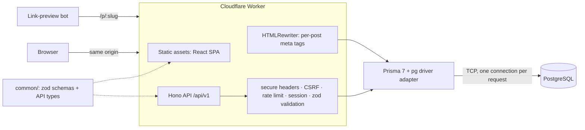

# Inkstack

**A writing platform for developers, running entirely on Cloudflare's edge.**
Markdown with real code highlighting, private drafts, tags and search, and
link previews that work when you share a post.


<!-- Add a screenshot or short GIF here: feed → post → editor → publish. -->

## Why

Developers learn things worth sharing every week, but the usual places to
publish them get in the way: paywalls and algorithmic feeds, heavyweight CMSs,
or a static-site setup where publishing means a git commit. Inkstack is the
small, fast option: write Markdown, keep it as a draft until it's ready,
publish to a public page that previews properly in Slack and on LinkedIn.

## Features

- **Markdown editor** with live preview, GitHub-flavoured Markdown (tables,
  task lists) and syntax-highlighted code blocks
- **Drafts** visible only to their author; publish, unpublish, edit and delete
- **Tags** (up to five per post), a **popular topics** list, and **full-text
  search** across titles and bodies
- **Public feed** with cursor pagination, **author profiles** with bios
- **Link previews**: each post page gets its own Open Graph/Twitter tags,
  injected at the edge ([ADR 0004](docs/adr/0004-single-worker-and-link-previews.md))
- **Accounts** with hashed passwords, HttpOnly session cookies, CSRF protection
  and rate-limited sign-in ([SECURITY.md](SECURITY.md))

## Architecture



| Layer | Tech |
|---|---|
| Web | React 18, TypeScript, Vite 6, Tailwind CSS, TanStack Query, React Router 7 |
| API | Hono 4 on Cloudflare Workers, zod validation |
| Data | PostgreSQL, Prisma ORM 7 with `@prisma/adapter-pg` |
| Shared | `@inkstack/common`: request schemas and response types used by both sides |
| Quality | Vitest in the real Workers runtime (workerd) and jsdom, ESLint + jsx-a11y, GitHub Actions |

### Engineering decisions

Each of these is written up as a short decision record:

1. [**Database access from Workers**](docs/adr/0001-database-access-from-workers.md):
   moved off Prisma Accelerate (retiring Dec 2026) to a direct driver adapter,
   and fixed a per-request connection leak found by the test suite.
2. [**Password hashing on Workers**](docs/adr/0002-password-hashing-on-workers.md):
   why the iteration count is 100,000 and not OWASP's 600,000. The production
   runtime caps it, and local tooling doesn't.
3. [**Sessions and CSRF**](docs/adr/0003-sessions-and-csrf.md): HttpOnly cookie
   on a single origin instead of a token in `localStorage`.
4. [**One Worker, link previews at the edge**](docs/adr/0004-single-worker-and-link-previews.md):
   SPA + API from one deploy, and `HTMLRewriter` for crawlers.

## API

All routes are under `/api/v1`. Errors are always
`{ "error": { "code", "message", "fields?" } }`.

| Method | Route | Auth | |
|---|---|---|---|
| `GET` | `/health` | — | Liveness + database check |
| `POST` | `/auth/signup` | — | Create an account, start a session |
| `POST` | `/auth/signin` | — | Start a session (rate-limited) |
| `POST` | `/auth/signout` | — | Clear the session cookie |
| `GET` | `/auth/me` | ✓ | The signed-in user |
| `GET` | `/posts?cursor&limit&tag&q&author` | — | Published posts, newest first |
| `GET` | `/posts/:slug` | optional | A post (drafts only for their author) |
| `POST` | `/posts` | ✓ | Create (draft by default) |
| `PATCH` | `/posts/:id` | owner | Edit, publish or unpublish |
| `DELETE` | `/posts/:id` | owner | Delete |
| `GET` | `/me/posts?status=all\|draft\|published` | ✓ | Your posts, including drafts |
| `PATCH` | `/me` | ✓ | Update name and bio |
| `GET` | `/users/:id` | — | Public profile |
| `GET` | `/tags` | — | Most-used tags |

## Run it locally

Requirements: **Node.js 22.12+**. No Docker or cloud account needed.

```bash
npm install                      # all workspaces; also generates the Prisma client
npm run db:local                 # starts a local Postgres (prisma dev) and prints its URL

cp backend/.env.example backend/.env
cp backend/.dev.vars.example backend/.dev.vars
# Put the printed postgres:// URL in both files (use 127.0.0.1, not localhost),
# and set JWT_SECRET in .dev.vars to a long random string.

npm run db:migrate -w backend    # create the tables
npm run db:seed -w backend       # optional: demo account + sample articles

npm run dev:api                  # API on http://127.0.0.1:8787
npm run dev:web                  # app on http://localhost:5173
```

Demo login after seeding: `demo@inkstack.app` / `inkstack-demo`.

Any Postgres works in place of `prisma dev`, e.g. a free [Neon](https://neon.tech) database.

> **Note on `prisma dev`:** the local server [accepts one connection at a time](https://www.prisma.io/docs/postgres/database/local-development).
> That's fine for clicking around, but stop `dev:api` before running the test suite,
> or point `TEST_DATABASE_URL` at a separate Postgres. Too many simultaneous clients
> can wedge it (every connection then resets); `npx prisma dev stop inkstack` and
> `npm run db:local` restarts it.

## Tests and checks

```bash
npm run typecheck   # all packages
npm run lint        # ESLint (incl. accessibility rules)
npm test            # API tests in workerd against Postgres + web tests in jsdom
npm run build       # production web build
```

The API suite covers sign-up and sign-in (including timing-equal failures,
legacy password upgrades, forged and expired tokens, rate limiting), drafts and
ownership rules, cursor pagination, search and tags, CSRF, security headers and
the link-preview HTML. The web suite covers Markdown sanitisation, forms, the
open-redirect guard and page states. CI runs everything against a Postgres
service container on every push.

## Deploy

```bash
cd backend
npx wrangler secret put DATABASE_URL --env production   # a hosted Postgres, e.g. Neon
npx wrangler secret put JWT_SECRET --env production
DATABASE_URL=<same url> npm run db:migrate
cd .. && npm run deploy                                  # builds the web app, deploys one Worker
```

## Project structure

```
backend/   Hono API + edge HTML rewriting (Cloudflare Worker), Prisma schema, tests
frontend/  React SPA
common/    zod schemas and response types shared by both
docs/adr/  architecture decision records
```

## Status and next steps

See [`PROJECT_AUDIT_AND_ROADMAP.md`](PROJECT_AUDIT_AND_ROADMAP.md) for the
audit this rebuild followed and what's still open, notably Hyperdrive pooling,
a Content-Security-Policy, password reset, and dark mode.

---

Inkstack began as a Medium-style learning project (see the early git history)
and was rebuilt around the problems in the audit above.
